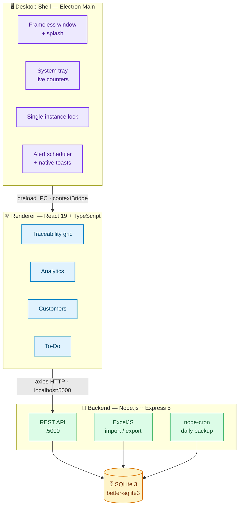

<div align="center">


# Project Traceability Suite

### Real-time production traceability for **Electronics & PCBA manufacturing**

Track every **project / job** from order sheet to dispatch — across an 11-stage shop-floor
pipeline — with a local-first SQLite engine, Excel import/export, and a native Windows shell.

<br />

<a href="#-overview"></a>
<a href="#-tech-stack"></a>
<a href="#-tech-stack"></a>
<a href="#-tech-stack"></a>
<a href="#-tech-stack"></a>
<a href="#-tech-stack"></a>
<a href="#-tech-stack"></a>
<a href="#-tech-stack"></a>
<a href="#-tech-stack"></a>
<a href="#-tech-stack"></a>
<a href="LICENSE"></a>

<br />

[Overview](#-overview) · [Features](#-key-features) · [Shop-Floor Pipeline](#-shop-floor-pipeline) · [Architecture](#-architecture) · [Tech Stack](#-tech-stack) · [Getting Started](#-getting-started) · [REST API](#-rest-api) · [Data & Backups](#-data--backups) · [Packaging](#-build--package)

</div>

---

## 📌 Overview

**Project Traceability Suite** is a high-performance **Windows desktop application** purpose-built for **Electronics & PCBA (Printed Circuit Board Assembly)** manufacturing floors.

Generic ERPs treat a job as a single status field. Real electronics manufacturing is a **multi-stage pipeline** — procurement, kitting, SMT, AOI, through-hole, QC, programming, testing, conformal coating, final goods and dispatch — where each station has its own start, due and completion dates, and where a single stalled stage silently delays the whole shipment.

The unit tracked is the **project / job** (a work order or manufacturing batch), not an individual board — so the dashboard reflects how the floor actually schedules, monitors and ships work.

This suite was engineered around that reality:

- **Project / job-centric.** One row per job, carrying its full 11-stage lifecycle, quantities and customer in a single record.
- **Local-first.** A bundled Express + SQLite engine runs on the machine. No cloud, no internet dependency, no latency on the shop floor.
- **Stage-aware.** Every project carries a full 11-stage timeline; the dashboard derives live status (Active / Completed / Overdue) from real stage dates.
- **Excel-native.** Floor teams keep working in Excel — import and export work orders and daily logs without changing their habits.
- **Desktop-native.** Frameless window, branded splash screen, system tray with live counters, native toast notifications and daily automated backups.

---

## ✨ Key Features

### 🏭 Production Traceability
- **11-stage shop-floor pipeline** per project — procurement to dispatch, each with Status, Start, Due and Done tracking.
- **Dispatch quantity control** — track shipped vs. remaining quantities for each job explicitly.
- **Dynamic custom columns** — extend the grid with plant-specific fields without a schema migration.

### 📊 Live Analytics & Monitoring
- **Stage aging analysis** — days spent in each stage, flagging bottlenecks and overdue stages.
- **Live statistics dashboard** — active, completed and overdue counts, plus upcoming/past-due alerts.
- **Per-project analytics modal** — a full timeline breakdown of where a job's time actually went.

### 🗂️ Business Data
- **Customer database** — full contact records (multi-contact name, phone, email, designation), searchable and paginated.
- **To-Do engine** — dated tasks with a red alert counter, in-app reminders and native notifications.
- **Due-date alert system** — surfaces at-risk projects with configurable snooze windows.

### 📁 Excel Synchronization
- **High-throughput import** — parse and map production Excel workbooks into the database (ExcelJS streaming under the hood).
- **Rich export** — generate styled, print-ready work orders and status sheets.
- **Automated daily backup** — a nightly job writes the entire database to a formatted Excel backup file.

### 🖥️ Desktop Experience
- **Frameless native shell** with a branded splash screen.
- **System tray** with live pending / completed / overdue counters at a glance.
- **Native toast notifications** for due alerts and reminders.
- **Session-scoped zoom** — temporary zoom that doesn't clobber your saved default.
- **Single-instance lock** — reopening focuses the existing window instead of spawning a duplicate.

---

## 🔄 Shop-Floor Pipeline

Every **project / job** flows through the same eleven stages, in order. Each stage records **Status**, **Start date**, **Due date** and **Done date**; **Dispatch** additionally records **Shipped Qty** and **Remaining Qty**.

```mermaid
flowchart LR
    S1["1 · Procurement<br/>Order Sheet"] --> S2["2 · Kitting"] --> S3["3 · SMT"] --> S4["4 · AOI"]
    S4 --> S5["5 · TH"] --> S6["6 · QC"] --> S7["7 · Programming"] --> S8["8 · Testing"]
    S8 --> S9["9 · Coating"] --> S10["10 · FG"] --> S11["11 · Dispatch<br/>+ Shipped / Remaining Qty"]

    classDef stage fill:#e0f2fe,stroke:#0284c7,stroke-width:1.5px,color:#0c4a6e;
    classDef last fill:#dcfce7,stroke:#16a34a,stroke-width:1.5px,color:#14532d;
    class S1,S2,S3,S4,S5,S6,S7,S8,S9,S10 stage;
    class S11 last;
```



> Status is **derived automatically** from stage dates — never stored stale. A job that passes its dispatch due date before completion is flagged **Overdue** in real time.

---

## 🛠️ Architecture

A three-tier local stack: a native desktop shell, a React renderer, and a bundled REST + SQLite engine — communicating over localhost.



The Electron main process **spawns the backend as a child process** and passes it a persistent `--base-dir`, so the database and backups always live in the writable app-data directory rather than inside the read-only bundle.

---

## 🧰 Tech Stack

| Layer | Technologies |
| :--- | :--- |
| **Desktop Shell** | Electron 41, preload `contextBridge`, system tray, Windows toasts, `electron-builder` (NSIS) |
| **Frontend** | React 19, TypeScript 6, Vite 5, Tailwind CSS v4, TanStack Table v8, Framer Motion, Lucide Icons |
| **Backend** | Node.js, Express 5, `better-sqlite3` 12, ExcelJS, node-cron, xlsx |
| **Storage** | SQLite 3 — persisted locally, left untouched on uninstall |
| **Packaging** | electron-builder → standalone Windows NSIS installer |

---

## 📁 Repository Structure

```plaintext
Project_Traceability_Suite/
├── backend/                     # Express REST API & SQLite engine
│   ├── package.json
│   └── server.js                # Routes, schema, stage structure, daily backup
├── client/                      # React 19 + Vite frontend
│   ├── public/                  # Favicon & static icons
│   ├── src/
│   │   ├── App.tsx              # Main traceability grid, state & alert engine
│   │   ├── components/          # Analytics, Customer, ChangeLog, Dropdown modals
│   │   ├── config/changelog.ts  # In-app release history
│   │   └── assets/              # Fonts, images, brand assets
│   ├── index.html
│   └── vite.config.ts
├── electron/                    # Desktop shell & packaging
│   ├── main.js                  # Window, tray, splash, backend spawn, IPC
│   ├── preload.js               # Secure renderer bridge
│   ├── splash.html              # Branded splash screen
│   ├── server/                  # Server copy bundled into the installer
│   ├── icon.ico / icon.png      # Application icons
│   └── package.json             # electron-builder configuration
├── package.json                 # Root workspace orchestration scripts
└── README.md
```

---

## 🚀 Getting Started

### Prerequisites

| Requirement | Version |
| :--- | :--- |
| **Node.js** | `20.x` or higher (built & tested on `24.x`) |
| **npm** | `9.x` or higher |
| **OS** | Windows 10 / 11 (desktop shell & installer packaging) |

> Native SQLite bindings are built via `node-gyp`. On Windows install the **"Desktop development with C++"** workload if a from-source build is ever required — most machines pull a prebuilt binary automatically.

### 1. Clone

```bash
git clone https://github.com/MZarc/Project_Traceability_Suite.git
cd Project_Traceability_Suite
```

### 2. Install all workspaces

```bash
npm run install:all
```

### 3. (If needed) rebuild the SQLite binding

```bash
npm run rebuild
```

### 4. Launch in development

```bash
npm run dev
```

This starts **all three** processes concurrently — the Vite dev server, the Express API on port `5000`, and the Electron desktop shell.

---

## 📜 Workspace Commands

| Command | Description |
| :--- | :--- |
| `npm run dev` | Run client (Vite), backend (Express) and Electron concurrently |
| `npm run build` | Production build of the React client |
| `npm run package` | Build client, sync assets, and produce the Windows installer |
| `npm run install:all` | Install dependencies across root, client, backend and electron |
| `npm run rebuild` | Rebuild the `better-sqlite3` native binary for the local environment |

---

## 🔌 REST API

The backend exposes a local REST API on **`http://localhost:5000`**.

| Method | Endpoint | Purpose |
| :--- | :--- | :--- |
| `GET` | `/api/projects` | List all traceability projects |
| `POST` | `/api/projects` | Create a project |
| `PUT` | `/api/projects/:id` | Update a project |
| `DELETE` | `/api/projects/:id` | Delete a project |
| `DELETE` | `/api/projects-clear` | Clear **all** projects |
| `GET` | `/api/customers` | List customers |
| `POST` | `/api/customers` | Create a customer |
| `PUT` | `/api/customers/:id` | Update a customer |
| `DELETE` | `/api/customers/:id` | Delete a customer |
| `GET` | `/api/todos` | List to-do items |
| `POST` | `/api/todos` | Create a to-do |
| `PUT` | `/api/todos/:id` | Update a to-do |
| `DELETE` | `/api/todos/:id` | Delete a to-do |
| `GET` | `/api/columns` | List dynamic grid columns |
| `POST` | `/api/columns` | Add a dynamic grid column |
| `POST` | `/api/import-excel` | Bulk-import a production Excel workbook |

---

## 💾 Data & Backups

- **Storage engine:** SQLite 3 via `better-sqlite3` (synchronous, transactional, fast).
- **Location:** the backend accepts a `--base-dir` argument; packaged builds point it at the app's user-data directory so a read-only install still has a writable database.
- **Automated backup:** a `node-cron` job runs **every day at midnight** (`0 0 * * *`) and writes the full dataset to a styled Excel workbook inside `backups/`.
- **Uninstall-safe:** `deleteAppDataOnUninstall` is disabled — your data survives reinstalls.

---

## 📦 Build & Package

Produce a distributable Windows installer:

```bash
npm run package
```

This will:

1. Build the React client (`tsc && vite build`)
2. Copy the web build into `electron/dist/`
3. Sync `backend/server.js` into `electron/server/`
4. Rebuild native modules for Electron's ABI and run `electron-builder`

Output:

```text
dist-exe/v1.4.0/Project Traceability Suite-Setup.exe
```

An NSIS installer (per-user, changeable install directory) with a patched application icon. Blueprints for macOS/Linux targets can be added in `electron/package.json`.

---

## 🗺️ Roadmap

- [ ] In-app screenshot gallery & onboarding tour
- [ ] Role-based access (operator / supervisor / admin)
- [ ] Scheduled email + Excel report delivery
- [ ] Multi-line / multi-plant database partitioning
- [ ] Code-splitting to shrink the initial renderer bundle

---

## 🤝 Contributing

Contributions, issues and feature requests are welcome — open an [issue](https://github.com/MZarc/Project_Traceability_Suite/issues) or submit a pull request.

1. Fork the repository
2. Create a feature branch (`git checkout -b feature/amazing-feature`)
3. Commit your changes (`git commit -m 'feat: add amazing feature'`)
4. Push the branch (`git push origin feature/amazing-feature`)
5. Open a Pull Request

Built and maintained by **[@MZarc](https://github.com/MZarc)**.

---

## 📄 License

Distributed under the **MIT License**. See [`LICENSE`](LICENSE) for details.

<div align="center">
<br />
<sub>Engineered for the shop floor · Electronics & PCBA Manufacturing · v1.4.0</sub>
</div>
